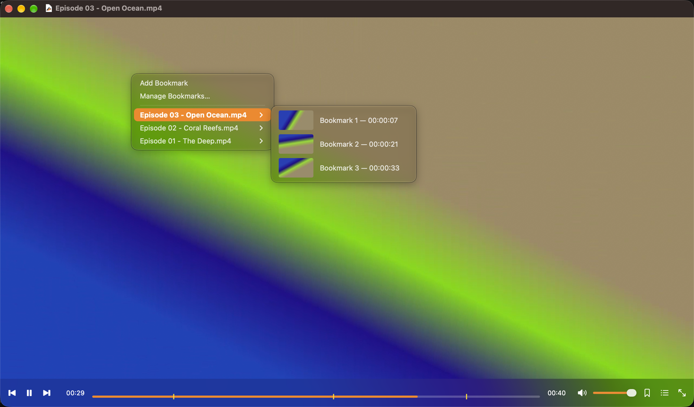

<p align="center">
  
</p>

<h1 align="center">Open Player</h1>

<p align="center">
  A lightweight video and audio player for Apple Silicon Macs, inspired by PotPlayer.<br>
  PotPlayer's keyboard shortcuts, bookmarks and folder playlists, as a native macOS app.
</p>

<p align="center">
  <a href="https://github.com/naazeri/open-player/releases/latest"><b>⬇ Download the latest release</b></a>
</p>

<p align="center">
  
</p>

## Features

- **PotPlayer shortcuts.** Space, arrow-key seeking (5 s, 30 s, 1 min, 5 min), C/X/Z speed,
  PageUp/PageDown for the next file, D/F frame stepping and more. Keys are matched by their
  physical position, so they also work with non-English keyboard layouts. Holding a seek,
  volume or speed key repeats quickly. Every shortcut and step is configurable.
- **Bookmarks.** Press **P** to bookmark the current moment, with a thumbnail. Press **H** for
  a menu of every bookmarked file (most recently changed first, current file in bold). Hover a
  file to see its bookmarks in time order, click one to jump there, right-click to rename or
  delete it. Bookmarks also appear as markers on the seek bar.
- **PotPlayer `.pbf` compatible.** If a PotPlayer bookmark file sits next to a video, Open Player
  reads it, keeps it up to date and treats it as the source of truth, so bookmarks stay in sync
  with PotPlayer on Windows (for example on an external drive).
- **Folder playlist.** Opening a file adds every video and audio file in its folder, in natural
  order (`Episode 2` before `Episode 10`), and plays them one after another.
- **Smart window.** The window takes the video's resolution (scaled to fit your screen). Audio
  files get a compact player bar instead of a black box.
- **Resume.** Every file continues where you stopped watching.
- **Speed control.** The speed is always shown in the control bar. Click it to step through
  1.0× → 1.25× → 1.5× → 1.75× → 2.0× and back to 1.0×; right-click for 1.0×. C/X change it in 0.1 steps.
- **Opens fast.** After you close the window, Open Player keeps running in the background, so the
  next file starts almost instantly (turn this off in **Settings → General** to quit on close).
- **Subtitles.** Same-name subtitles load automatically, with encoding auto-detection
  (Windows-1256 can be forced for older Persian/Arabic `.srt` files), and adjustable font and size.
- **Fast and efficient.** Built on [mpv](https://mpv.io) with VideoToolbox hardware decoding.
  Plays practically every format: MKV, MP4, AVI, WebM, HEVC, AV1, FLAC, and many more.
- **Backup.** Export settings, shortcuts, bookmarks and resume positions to one file and import
  them on another Mac.
- **Update notifications.** Open Player checks GitHub once a day and tells you when a new version
  is available (can be turned off in Settings).

## Install

1. Download `Open-Player-<version>-macOS-arm64.zip` from the
   [latest release](https://github.com/naazeri/open-player/releases/latest) and unzip it.
2. Drag **Open Player.app** into your **Applications** folder.
3. Open it. The app is not notarized by Apple, so the first launch is blocked:
   open **System Settings → Privacy & Security**, scroll down and click **Open Anyway**.
   Alternatively, run this once in Terminal:

   ```bash
   xattr -dr com.apple.quarantine "/Applications/Open Player.app"
   ```

To make it your default player, select a video in Finder, press **⌘I**, choose Open Player under
**Open with**, and click **Change All…**.

### Requirements

- A Mac with Apple Silicon (M1 or later).
- The downloadable build needs **macOS 27 or later**, because it bundles libraries built for that
  version. On older macOS versions, build it from source (below); it supports macOS 14 and later.

## Default shortcuts

| Action | Keys |
|---|---|
| Play / pause | Space, click on the video |
| Seek 5 s / 30 s / 1 min / 5 min | ← → · Ctrl+← → (or ⌘+← →) · Shift+← → · Ctrl+Alt+← → |
| Previous / next frame | D / F |
| Speed down / up / normal | X / C / Z |
| Volume / mute | ↑ ↓, mouse wheel / M |
| Previous / next file | PageUp / PageDown (Fn+↑ / Fn+↓ on a MacBook) |
| Add bookmark / bookmark menu | P / H |
| Fullscreen | Enter, Alt+Enter, double-click |
| Jump to time / jump to start | G / Backspace |
| Subtitles: show/hide · cycle · load | Alt+H · Alt+L · Alt+O |
| Subtitle sync − / + / reset | , / . / / |
| Audio track / audio sync | Alt+A / Shift+, Shift+. |
| Window size 0.5× / 1× / 1.5× / 2× | 1 / 2 / 3 / 4 |
| Stay on top / playback info | Ctrl+T / Tab |
| Open file / open folder / close | Ctrl+O, F3, ⌘O / F2 / F4 |
| Settings / playlist | F5, ⌘, / F6 |
| Save the current frame to the Desktop | Ctrl+E |

Change any of them in **Settings → Shortcuts**. macOS reserves Ctrl+←/→ for switching Spaces; to
use them in the player, turn them off in **System Settings → Keyboard → Keyboard Shortcuts →
Mission Control**, or use the ⌘ variants.

## Build from source

Requirements: Xcode and [Homebrew](https://brew.sh).

```bash
brew install mpv xcodegen dylibbundler
git clone https://github.com/naazeri/open-player.git
cd open-player
scripts/build.sh release
```

This creates `build/Open Player.app` (with libmpv bundled inside) and a zip next to it.
`scripts/build.sh` without arguments makes a Debug build that links Homebrew's libmpv.
For Xcode, run `xcodegen generate` and open `OpenPlayer.xcodeproj`.

### Project layout

```
OpenPlayer/                   macOS app (AppKit + SwiftUI)
  MPV/                        libmpv wrapper, OpenGL video layer, thumbnail grabber
  Player/                     window, control bar, seek bar, keyboard handling
  Bookmarks/                  H menu, bookmark manager, .pbf sync
  Settings/                   settings window, backup
Packages/OpenPlayerCore/      platform-independent logic with unit tests
scripts/build.sh              build and packaging
```

Run the unit tests with:

```bash
cd Packages/OpenPlayerCore && swift test
```

Debug builds accept `OPEN_PLAYER_IPC_SOCKET=/path/to.sock`, which opens mpv's JSON IPC socket.
Besides normal mpv commands, `script-message op-action <action>`, `op-key <down|up> <combo>`,
`op-open <path>` and `op-dump` drive the player for automated checks.

## Data

Settings and the bookmark database live in `~/Library/Application Support/Open Player/`.
Use **File → Export Backup…** to move them to another Mac.

## License

Open Player's source code is released under the [MIT License](LICENSE).

Release builds bundle [mpv](https://github.com/mpv-player/mpv), [FFmpeg](https://ffmpeg.org)
and their dependencies from Homebrew. Those libraries keep their own licenses (GPL/LGPL), and a
release binary as a whole is distributed under the terms of the GPL. Their source code is
available from the linked projects.

Open Player is not affiliated with PotPlayer or Kakao.
